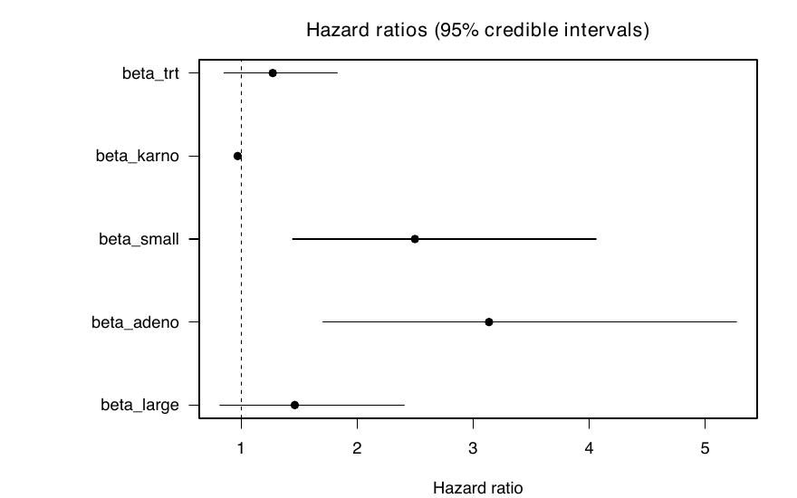

# bayes-weibull-veteran

Bayesian Weibull regression on the Veterans' Administration lung cancer data, fitted with JAGS. Course project for Bayesian Data Analysis at KU Leuven, spring 2026.

## Model

Data: `veteran` from the R `survival` package. The analysis uses the 128 observed deaths only. The 9 censored patients are dropped, which biases survival downwards. A fuller analysis would keep them as censored observations.

```
time[i] ~ Weibull(k, lambda[i])
log(lambda[i]) = -(beta0 + beta_trt * trt2 + beta_karno * karno_c
                   + beta_small * smallcell + beta_adeno * adeno + beta_large * large)
```

Reference group: standard treatment, squamous cell type, mean Karnofsky score. Priors are vague: `N(0, 1e6)` on the coefficients and `Gamma(0.001, 0.001)` on the shape `k`. The model file is `model/project1_weibull.bug`.

Three chains, 1,000 adaptation, 10,000 burn-in, 20,000 kept per chain.

## Results

Convergence: R-hat is at most 1.001 for every parameter. Effective sample size is lowest for `beta0` (844) and `k` (1,019) out of 60,000 draws.

Hazard ratios, posterior median and 95% credible interval:

| Covariate | HR | 95% CrI |
|---|---|---|
| Test treatment vs standard | 1.25 | 0.85 to 1.83 |
| Karnofsky score, per point | 0.970 | 0.960 to 0.980 |
| Small cell vs squamous | 2.41 | 1.44 to 4.06 |
| Adeno vs squamous | 3.01 | 1.71 to 5.27 |
| Large cell vs squamous | 1.41 | 0.82 to 2.41 |



Median survival under standard treatment at the mean Karnofsky score is about 143 days for squamous, 117 for large cell, 52 for small cell and 46 for adeno. The posterior probability that the median exceeds 100 days is 0.95 for squamous, 0.78 for large cell, and below 0.001 for the other two.

The interval for the treatment effect includes 1. The posterior probability that a standard-treatment patient has higher 60-day survival than a test-treatment patient with the same covariates is 0.87.

All tables are in `outputs/tables/`, figures in `outputs/figures/`.

## Running it

Needs R, JAGS, and the packages `rjags`, `coda`, `survival`.

```
Rscript R/project1_all.R
```

Run it from the repo root. It takes about 15 seconds.
